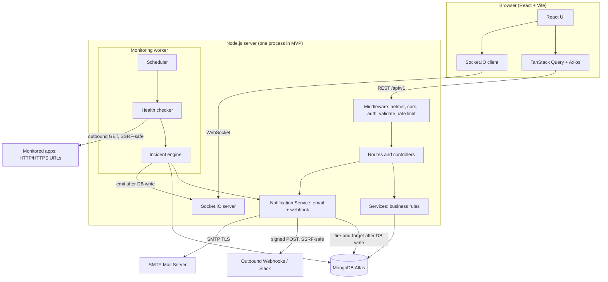
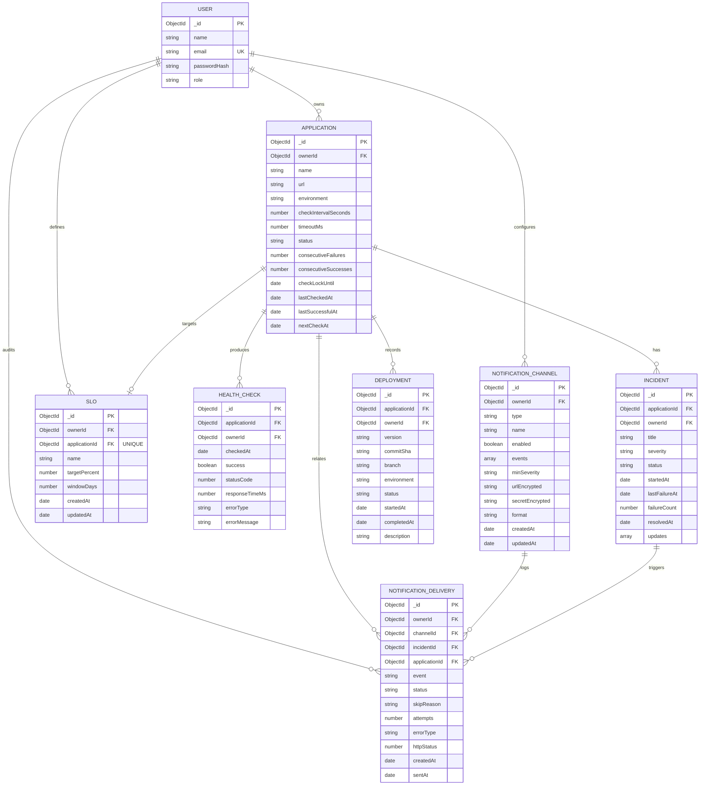

# DevOpsPulse: Architecture and Data Model

This file is the design contract. Code must follow it. If a change is needed, update this file first.

## 1. System architecture



### Layer rules
- Routes only map URLs to controllers. Controllers only parse input and send responses.
- All business logic lives in services. Services never touch `req` or `res`.
- Every query on private data is scoped by `ownerId = req.user._id`.
- Socket.IO events are emitted only AFTER the database write succeeds.
- The scheduler never blocks the API: bounded concurrency, timeouts on every outgoing request.

### Backend folder structure
```
backend/src/
  config/        env.js, db.js
  models/        User, Application, HealthCheck, Incident, Deployment, NotificationChannel, NotificationDelivery, Slo
  middleware/    auth, validate, errorHandler, rateLimiters
  routes/        auth, applications, incidents, deployments, dashboard, notifications, sloRoutes
  controllers/   authController, applicationController, healthCheckController, notificationController, sloController
  services/      authService, applicationService, healthCheckService, statusService, schedulerService, urlSafetyService, notificationService, notificationRules, sloService, sloRules
  sockets/       index.js (auth + rooms + emit helpers)
  utils/         AppError, asyncHandler, crypto
```

### Frontend folder structure
```
frontend/src/
  api/           axios instance + one file per resource
  components/    shared UI (Button, Card, StatusBadge, Table, Pagination)
  features/      auth, applications, incidents, deployments, dashboard, slos
  hooks/         useAuth, useSocket, useApplications, useDebounce
  pages/
  routes/        ProtectedRoute, PublicOnlyRoute
```

## 2. ER diagram



### Data decisions
- `ownerId` is stored on every child collection (denormalized) so each query can be scoped to the user without joins.
- `Incident.updates` is an embedded array: `{ message, author, type, createdAt }`. An incident's notes are always read together with the incident.
- Application `status`: `unknown | up | degraded | down`. Incident `status`: `open | investigating | resolved`.
- Application `consecutiveFailures`: counter to enforce failure threshold before marking `down`.
- Application `consecutiveSuccesses`: counter to enforce recovery threshold (2 consecutive successes required to transition from `down` to `up`).
- Application `checkLockUntil`: atomic distributed lease/lock timestamp preventing overlapping or concurrent checks across scheduler ticks and multi-process workers.
- Deleting an application permanently cascades to delete its health checks, incidents, deployments, and its SLO record (`Slo` collection). It does NOT delete notification deliveries, as deliveries form an immutable audit trail.
- Deleting a `NotificationChannel` cascades to delete its `NotificationDelivery` history records.
- Notification secrets (`urlEncrypted`, `secretEncrypted`) are encrypted with AES-256-GCM. Webhook signing secret is returned only once at creation or rotation.
- Unique index on `NotificationDelivery { channelId, incidentId, event }` enforces exact deduplication so identical alerts are never dispatched twice.
- TTL index of 30 days on `NotificationDelivery.createdAt` automatically purges stale delivery logs.
- Unique index on `Slo { applicationId: 1 }` enforces a 1-to-1 relationship per application in MVP.
- Compound index on `Slo { ownerId: 1, createdAt: -1 }` optimizes user SLO listings.
- User quota: A maximum of 20 SLOs can be configured per account (`ownerId`).
- Query performance: SLO calculation uses MongoDB aggregation leveraging the `{ applicationId: 1, checkedAt: -1 }` index with index scan (`IXSCAN`) and 0 collection scans (`COLLSCAN`).
- Indexes: `User.email` unique; `Application {ownerId, createdAt}`; `HealthCheck {applicationId, checkedAt}` (+ TTL); `Incident {ownerId, status, startedAt}`; `Deployment {applicationId, createdAt}`; `NotificationChannel {ownerId, createdAt}`; `NotificationDelivery {ownerId, createdAt: -1}`; `Slo {applicationId}` unique; `Slo {ownerId, createdAt: -1}`.
- No duplicate active incidents: a partial unique index on `{ applicationId }` where `status` is `open` or `investigating`.

## 3. Monitoring rules (documented, testable)
- New app starts as `unknown`.
- Check success: 2xx/3xx within timeout. Slow success (above 2000 ms) makes the app `degraded`.
- 2 consecutive failures: status `down` and an incident is opened (if none is active).
- Further failures: update the active incident (`failureCount`, `lastFailureAt`).
- 2 consecutive successes: status `up` and the incident is resolved.
- Uptime % = successful checks / total checks in the selected window. Apps with no checks show "no data", not 0%.

## 4. SLO monitoring rules (documented, testable)
- SLI = good checks / total recorded checks in window (`good` = `HealthCheck.success === true`).
- Allowed error rate = `(100 - targetPercent) / 100`.
- Error rate = `bad / total`.
- Budget consumed % = `(errorRate / allowedErrorRate) * 100`.
- Budget remaining % = `max(0, 100 - budgetConsumedPct)`.
- Status: `insufficient_data` (< 20 checks), `healthy` (< 50% consumed), `at_risk` (50% to 100% consumed), `breached` (> 100% consumed).
- Window coverage = `min(100, daysOfData / windowDays * 100)`. If `< 50%`, `partialWindow: true`.
- Burn rate over lookback $L$ = `errorRate_L / allowedErrorRate`. Flags: `fastBurn` (1h >= 14.4), `slowBurn` (6h >= 6.0).
- Burn-down series: UTC daily buckets with cumulative budget consumed relative to total window budget. Empty days carry forward previous cumulative value.

