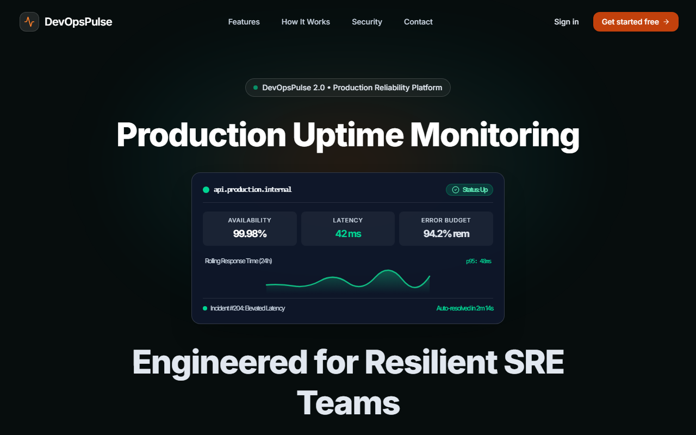
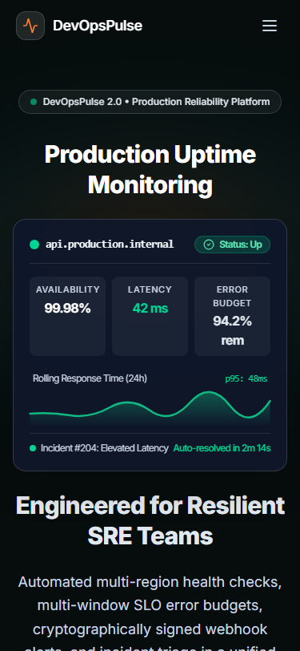
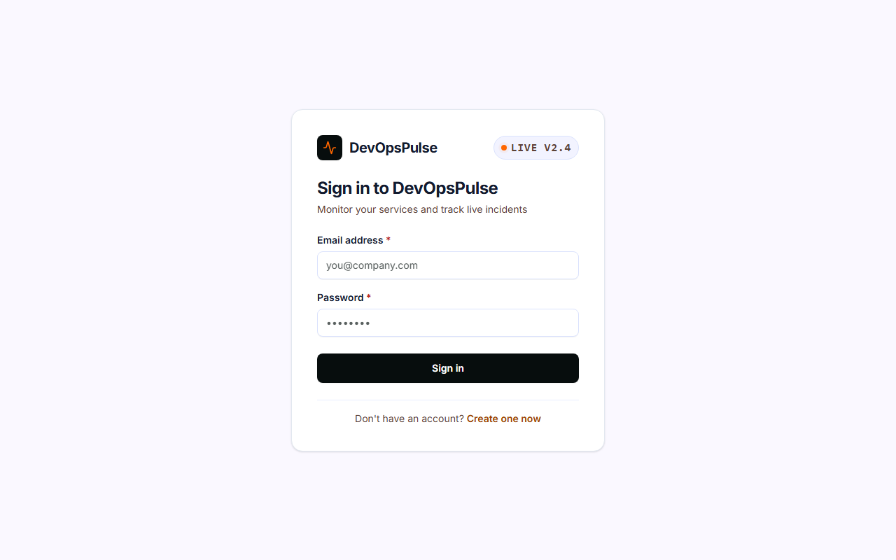
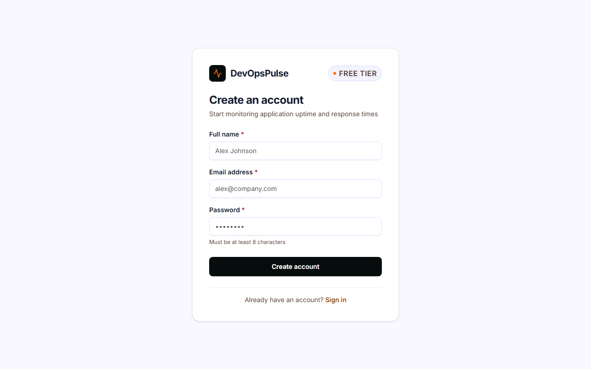

# DevOpsPulse

DevOpsPulse is an application monitoring and incident management platform built with the MERN stack (MongoDB, Express, React, Node.js). It provides automated HTTP/HTTPS health checks, response-time tracking, outage detection, incident workflows, deployment tracking, and a real-time operational dashboard.

## Tech Stack

- **Frontend**: React 18, Vite, React Router v6, TanStack Query v5, Axios, Tailwind CSS v4, Lucide React
- **Backend**: Node.js (ES modules), Express, MongoDB, Mongoose, Zod, bcryptjs, jsonwebtoken, helmet, cors
- **Security**: SSRF protection, tenant isolation scoped by `ownerId`, rate limiting, httpOnly JWT cookies

## Project Structure

```
DevOpsPulse/
├── backend/
│   ├── src/
│   │   ├── config/        # Environment and DB connection
│   │   ├── controllers/   # Request/response handlers
│   │   ├── middleware/    # Auth, validation, error handling, rate limiting
│   │   ├── models/        # Mongoose schemas (User, Application)
│   │   ├── routes/        # Express route definitions
│   │   ├── services/      # Business logic (auth, applications, urlSafety)
│   │   ├── utils/         # AppError, asyncHandler
│   │   ├── app.js         # Express app configuration
│   │   └── server.js      # Server entry point
│   ├── .env.example
│   └── package.json
└── frontend/
    ├── src/
    │   ├── api/           # Axios instance and API modules
    │   ├── components/    # Reusable UI components and AppLayout
    │   ├── hooks/         # Custom hooks (useAuth)
    │   ├── pages/         # Login, Register, Dashboard, NotFound
    │   ├── routes/        # ProtectedRoute, PublicOnlyRoute
    │   ├── App.jsx
    │   └── main.jsx
    ├── .env.example
    └── package.json
```

## Getting Started

### 1. Backend Setup
```bash
cd backend
cp .env.example .env
# Configure MONGO_URI and JWT_SECRET in .env
npm install
npm run dev
```
Backend runs on `http://localhost:5000`.

### 2. Frontend Setup
```bash
cd frontend
cp .env.example .env
npm install
npm run dev
```
Frontend runs on `http://localhost:5173`.

## Features & Capabilities

- **Automated Health Checks**: HTTP/HTTPS monitoring with configurable intervals (10s to 1h), timeout enforcement, and status classification (up, down, degraded).
- **Incident Management**: State-machine driven incident lifecycle (`open`, `investigating`, `identified`, `monitoring`, `resolved`), timeline notes, and automatic recovery.
- **Deployment Markers**: Correlate deployment events across production and staging with health metrics and response times.
- **Real-Time Telemetry**: WebSocket-driven dashboard updates and live query cache invalidation.
- **Alerting & Notifications (Release 2)**:
  - Outbound notifications for `incident_opened` and `incident_resolved` events.
  - Email alerts via SMTP to the account owner with HTML/plain-text bodies and XSS/header injection protection.
  - Webhooks with HMAC-SHA256 signatures (`X-DevOpsPulse-Signature`) supporting generic JSON and Slack-compatible formats.
  - Defense-in-depth SSRF protection on webhook destinations using connect-time DNS validation (`buildSafeLookup`) and redirect blocking.
  - AES-256-GCM encryption at rest for webhook URLs and secrets.
  - Pure rule engine with minimum severity thresholds, anti-flapping cooldowns (5m), and per-user hourly rate caps (30/hr).
  - Deduplication unique index ensuring zero duplicate alerts per incident event.

- **Service Level Objectives (SLO) Monitoring (Release 3 - End-to-End)**:
  - Check-count based SLI reliability metrics evaluated across 7-day or 30-day rolling windows.
  - User-defined targets between 90.000% and 99.999% (up to 3 decimal places) using integer thousandths arithmetic.
  - Real-time error budget tracking: budget consumed %, budget remaining %, and health classification (`healthy`, `at_risk`, `breached`, `insufficient_data`).
  - Multi-window burn rate tracking over 1-hour (`burnRate1h`) and 6-hour (`burnRate6h`) lookback intervals with fast-burn (`>= 14.4`) and slow-burn (`>= 6.0`) alert flags.
  - Daily UTC burn-down time series with forward carry-over for empty days.
  - Pre-aggregated `HealthCheckDaily` rollups with 0 `COLLSCAN` operations on index-covered queries.
  - **Full Frontend User Experience**:
    - Dedicated `/slos` overview page featuring a desktop table, mobile card layout, and status filter pills (`all`, `healthy`, `at_risk`, `breached`, `insufficient_data`).
    - Embedded SLO management in `ApplicationDetailsPage`: visual status badge, semi-circular SVG error budget gauge, multi-window burn rate cards with animated fast-burn warning banner, and daily burn-down chart.
    - Zero-friction SLO modal dialog for creating/editing targets and rolling windows with instant TanStack Query cache invalidation.
    - WebSocket real-time live invalidation triggering automatic UI refresh on health check completions and incident events.
    - Fully responsive across desktop (1280px+), tablet, and mobile (360px+) viewports with WCAG AA compliant contrast ratios and minimum 40px touch targets.
  - **SLO Alerting & State Machine (Release 3 - Step 16)**:
    - Pure rule engine (`decideSloEvents`) with 2-evaluation (>= 60s) transition debouncing.
    - 8 event types integrated into unified notification dispatch (email, webhook, WebSocket).
    - Optimistic concurrency locking (`{ sloId, version }`) for multi-worker safe evaluation.
    - Delivery deduplication via partial unique index `{ channelId, dedupeKey }`.

- **Public Landing Page & Contact System (Step 17)**:
  - Dark, modern responsive landing page (`/`) with sticky navigation, accessible skip link, and dynamic authentication actions (`Sign in` / `Get started free` vs. `Open dashboard`).
  - Hero visual featuring live status card with real-time SVG sparkline animation, auto-resolving incident badge, and SRE value metrics.
  - Core platform feature grid highlighting endpoint monitoring, incident state machines, SLO error budgets, WebSocket streams, signed alerts, and maintenance windows.
  - 3-step setup walkthrough and comprehensive security architecture facts (httpOnly cookies, SSRF guard, AES-256-GCM encryption, HMAC signing, multi-tenant isolation).
  - Public contact form with client and server-side validation, anti-spam honeypot field (`website`), and resilient plain-text email delivery with CRLF sanitization.
  - WCAG AA compliant contrast ratios across dark and light surfaces, minimum 40px touch targets, zero layout shift, and full adherence to `prefers-reduced-motion`.

### Screenshots

| Desktop Landing Page | Mobile Landing Page (375px) |
|---|---|
|  |  |

| Sign In Screen | Account Registration Screen |
|---|---|
|  |  |

### SLO Alerting Events & Thresholds

| Event | Severity | Trigger Transition / Condition | Description & Payload |
|---|---|---|---|
| `slo_at_risk` | `medium` | `healthy` \| `insufficient_data` &rarr; `at_risk` | Error budget consumed &gt; 50%; reports target, SLI, consumed % |
| `slo_breached` | `critical` | Any &rarr; `breached` | Error budget exhausted (100% consumed); increments episode counter |
| `slo_high_burn_rate` | `critical` / `high` | Lookback burn rates exceed thresholds | `critical` when 1h &ge; 14.4x & 6h &ge; 6.0x; `high` when 6h &ge; 6.0x & 1h &ge; 6.0x. Clears when 6h &lt; 3.0x (hysteresis) |
| `slo_recovered` | `low` | `breached` &rarr; `at_risk` \| `healthy` | Sent only if corresponding breach episode was dispatched to channel |
| `slo_budget_replenished` | `low` | `at_risk` &rarr; `healthy` | Sent when budget recovers to healthy (&le; 50% consumed) |
| `slo_insufficient_data` | `low` | Age &gt; 2 &times; 20 &times; interval and &lt; 20 checks | Low data volume warning with coverage % |
| `slo_monitoring_unavailable` | `high` | No check for &gt; max(3 &times; interval, 300s) | Health check execution ceased while app has history |
| `slo_monitoring_restored` | `low` | Checks resume after unavailable | Sent once when health checks resume after unavailable event |

#### Alerting Thresholds & Environment Variables

- `SLO_BURN_FAST_1H` (default: `14.4`): Fast 1-hour burn-rate threshold.
- `SLO_BURN_SLOW_6H` (default: `6.0`): Slow 6-hour burn-rate threshold.
- `SLO_BURN_CLEAR_6H` (default: `3.0`): Hysteresis clear threshold for 6-hour burn-rate.
- `SLO_ALERT_COOLDOWN_MINUTES` (default: `30`): Suppression period per `(sloId, event)`; exempts `slo_recovered`, `slo_budget_replenished`, and `slo_monitoring_restored`.

### Known Limitations

- **SLO Alerting Limitations**:
  - **Check-count based SLOs**: Evaluates binary health check success/failure counts only; custom latency percentiles (P95/P99) are not evaluated for SLO alerts.
  - **Single scheduler process**: Background 60s stale monitoring sweep runs via the in-process scheduler; multi-worker environments rely on optimistic locking on `SloAlertState` rather than a distributed lock manager.
  - **No per-SLO threshold overrides**: Burn rate thresholds (`14.4x`, `6.0x`, `3.0x`) and cooldown durations are configured globally via environment variables rather than on a per-SLO basis.

- **SLO daily rollups architecture & trade-offs**: SLO evaluation utilizes pre-aggregated `HealthCheckDaily` rollups to eliminate full-window raw check scans. Current architectural trade-offs: (1) rollups are atomically maintained on each check result by the application process; (2) rollups operate at UTC daily granularity rather than hourly; (3) the initial boundary day `[windowStart, endOfBoundaryDay)` queries raw checks to preserve exact rolling window precision; and (4) only `total` and `good` counts are tracked in rollups, with short lookbacks (1h, 6h burn rates) querying indexed raw checks.
- **In-process, non-durable retries**: Webhook delivery retries (1s, 5s, 30s) are managed in-process with bounded concurrency (max 5 in flight). If the server crashes or restarts mid-flight, pending deliveries older than 2 minutes are marked as `failed` with error type `interrupted` upon restart rather than resumed from an external durable message broker (e.g. RabbitMQ or Redis Streams).
- **Account-owner email only**: Email notifications are dispatched exclusively to the verified account owner's email address. Arbitrary third-party recipients are disallowed by design to prevent open-relay spam abuse.
- **No SMS or native push**: Alerting supports Email and Webhooks only. SMS and mobile push notifications are out of scope for Release 2.
- **Rolling windows only**: SLO evaluation uses rolling 7-day or 30-day lookbacks. Calendar-month and quarterly windows are not supported in MVP. An application's SLO uses all health checks recorded for it, including those from before a URL change.
- **Single availability SLI**: SLOs evaluate check-count availability (`HealthCheck.success === true`). Custom latency-threshold SLIs (e.g., P99 latency < 200ms) and multi-SLO configurations per application are deferred to subsequent releases.

